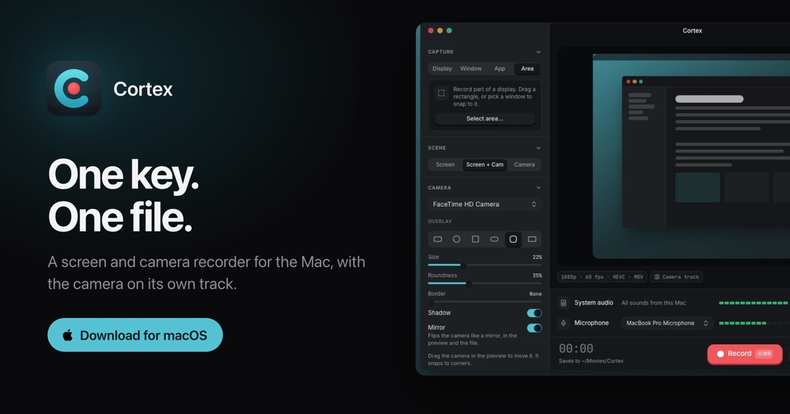

# Cortex

A screen and camera recorder for Mac, Windows and Linux. One key starts it, and you get one file for your editor.

[Website](https://cortex.roobi.dev) · [Download](https://github.com/roobiwebdev/cortex-releases/releases/latest) · [Release notes](https://github.com/roobiwebdev/cortex-releases/releases)



Cortex records a display, a window or just an area in up to true 4K, with your camera, mic and system audio, into one file. Press ⇧⌘R from any app to start on the Mac, or Ctrl+Shift+R on Windows and Linux. On the Mac it adds true 4K, Quick trim, a replay buffer and Go live.

Cortex is built by [Roobi](https://roobi.dev). The capture engine started as [Rec (rec-rs)](https://github.com/michaelshimeles/rec-rs) by Michael Shimeles, imported with its history.

## Features

The current release is 0.1.2. The Windows and Linux builds are in beta.

| Feature                                | macOS | Windows                            | Linux                              |
| -------------------------------------- | ----- | ---------------------------------- | ---------------------------------- |
| Record a display, a window or an area  | Yes   | Yes                                | Picked in the system dialog        |
| True 4K (3840 pixels wide, 60 fps)     | Yes   | Beta, depends on the graphics card | Beta, depends on the graphics card |
| Every window of one app                | Yes   | Not yet                            | No (Wayland)                       |
| Camera overlay, mic and system audio   | Yes   | Yes                                | Yes                                |
| Camera on its own track                | Yes   | Not yet                            | Yes                                |
| Start and stop from any app            | Yes   | Yes                                | If the desktop supports it         |
| Keeps its own windows out of the video | Yes   | Windows 10 2004 and later          | No (Wayland)                       |
| Live preview                           | Yes   | Not yet                            | Not yet                            |
| Quick trim                             | Yes   | Not yet                            | Not yet                            |
| Replay buffer                          | Yes   | Not yet                            | Not yet                            |
| Go live                                | Yes   | Not yet                            | Not yet                            |
| ProRes                                 | Yes   | No                                 | No                                 |

The table mirrors `FEATURES` in [`apps/site/src/lib/site.ts`](apps/site/src/lib/site.ts), which the website reads from.

## Download

Every file is on the [latest release](https://github.com/roobiwebdev/cortex-releases/releases/latest). Installed copies update themselves.

| System  | Requirements                                                    | File                                                                                                                                                                                         |
| ------- | --------------------------------------------------------------- | -------------------------------------------------------------------------------------------------------------------------------------------------------------------------------------------- |
| macOS   | macOS 15 Sequoia or later, Apple Silicon or Intel               | `Cortex-macOS.dmg` (universal)                                                                                                                                                               |
| Windows | Windows 10 (version 2004) or Windows 11, 64-bit                 | `Cortex-Windows-x64-Setup.exe` or `Cortex-Windows-x64.msi`                                                                                                                                   |
| Linux   | x86_64 or arm64, PipeWire and xdg-desktop-portal, WebKitGTK 4.1 | x86_64: `Cortex-Linux-x86_64.AppImage`, `cortex-linux-amd64.deb`, `cortex-linux-x86_64.rpm`<br>arm64: `Cortex-Linux-aarch64.AppImage`, `cortex-linux-arm64.deb`, `cortex-linux-aarch64.rpm` |

Linux builds target Ubuntu 24.04, Fedora 40, Debian 13 or newer, and Arch-based systems. The `.deb` and `.rpm` packages pull in WebKitGTK and GStreamer.

### Install from a terminal

The install scripts download the latest release and put it in place. A file fetched this way isn't flagged as coming from the internet, so macOS and Windows don't block the first launch.

```sh
# macOS and Linux
curl -fsSL https://cortex.roobi.dev/install.sh | sh
```

```powershell
# Windows (PowerShell)
irm https://cortex.roobi.dev/install.ps1 | iex
```

On macOS the script copies Cortex.app into `/Applications`. On Linux it installs the AppImage as `~/.local/bin/cortex` with a menu entry.

### First run

The Mac app isn't notarized and the Windows installers aren't code-signed yet, so a browser download needs one extra step.

- **macOS.** Open the DMG and drag Cortex to Applications. The first time, macOS says it could not verify that Cortex is free of malware. Click Done, open System Settings > Privacy & Security, scroll down and click Open Anyway. Then allow Screen Recording when Cortex asks.
- **Windows.** Run the installer. If Windows says "Windows protected your PC", click More info, then Run anyway. It installs for your user only and adds WebView2 if it is missing.
- **Linux.** Run the AppImage with `chmod +x Cortex-Linux-x86_64.AppImage && ./Cortex-Linux-x86_64.AppImage`, or install the package for your distribution with `sudo apt install ./cortex-linux-amd64.deb` or `sudo dnf install ./cortex-linux-x86_64.rpm`. The AppImage needs FUSE 2 (`libfuse2t64` on Ubuntu 24.04).

## Build from source

You need Rust (through rustup; `rust-toolchain.toml` pins 1.99.1), Node 22 or later and pnpm 11.

```sh
git clone https://github.com/roobiwebdev/Cortex.git
cd Cortex
pnpm install
```

Then, from the repository root:

```sh
pnpm --filter desktop tauri dev              # run the app with hot reload
pnpm --filter desktop tauri build --debug    # build a debug bundle
pnpm --filter desktop dev                    # UI only, in the browser on :3002, against a mock engine
cargo test --workspace                       # Rust tests
pnpm --filter site dev                       # the website on :3010
```

Each platform needs its own system packages:

- **macOS.** Xcode command line tools. The engine uses ScreenCaptureKit APIs from macOS 15, and the streaming code builds a Swift package.
- **Windows.** Visual Studio 2022 Build Tools with the "Desktop development with C++" workload. See [`docs/engineering/windows-testing.md`](docs/engineering/windows-testing.md).
- **Linux.** The WebKitGTK, PipeWire and GStreamer development packages. [`docs/engineering/linux-testing.md`](docs/engineering/linux-testing.md) has the `apt` and `dnf` lines for Ubuntu, Debian and Fedora.

Release builds, signing and the updater are covered in [`docs/engineering/releasing.md`](docs/engineering/releasing.md).

## Tech stack

- **App shell.** Tauri 2, written in Rust.
- **Interface.** React 19, Vite and Tailwind CSS 4. The TypeScript IPC types are generated from the Rust commands with tauri-specta.
- **macOS engine.** ScreenCaptureKit for screen and system audio, AVFoundation for camera, mic and file writing, VideoToolbox for H.264 and HEVC.
- **Windows engine.** Windows.Graphics.Capture, Media Foundation and WASAPI.
- **Linux engine.** The xdg-desktop-portal ScreenCast picker over PipeWire, with GStreamer for encoding.
- **Website.** SvelteKit, prerendered, forked from Rec's site.

## Project structure

```
apps/desktop               The Cortex app: React UI in src/, Tauri shell in src-tauri/
apps/site                  cortex.roobi.dev (SvelteKit)
crates/rec-core            Platform-neutral settings, engine API and state
crates/rec-engine-macos    macOS capture and encode engine
crates/rec-engine-windows  Windows engine
crates/rec-engine-linux    Linux engine
crates/rec-macos-ui        Native macOS window behaviour (panels, preview, capture exclusion)
crates/rec-cli             The rec-rs command-line recorder
packages/ui                Shared UI components and the recorder's design tokens
docs/engineering           Design notes: desktop.md, platforms.md, releasing.md, site.md
third_party                Patched copies of upstream crates
```

The repository started from a SaaS starter template. Its web, native and docs apps (`apps/web`, `apps/native`, `apps/docs`) and the server packages (`packages/api`, `auth`, `core`, `db`) are still in the tree, but Cortex doesn't use them.

Read [`docs/engineering/desktop.md`](docs/engineering/desktop.md) before changing the app. It covers the path from the UI to the engine, the IPC allow-list, and the rules each crate follows.

## Licence

The repository has no top-level licence file yet. The Rust crates and the desktop app declare `MIT OR Apache-2.0` in their `Cargo.toml`. Code from Rec and the forked website are under MIT or Apache 2.0, with the licence texts next to them. [`NOTICE`](NOTICE) credits every third-party source, and [`apps/desktop/THIRD_PARTY_RUST.md`](apps/desktop/THIRD_PARTY_RUST.md) lists each Rust dependency with its licence.
